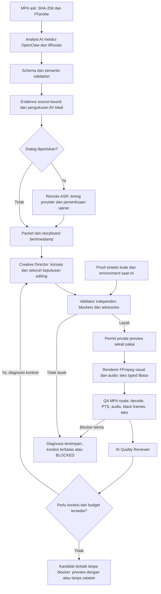

# Ringkasan pekerjaan dan arsitektur akhir Stage 5

Tanggal laporan: 14 Oktober 2026. Proyek: `/home/nndoo/Projects/mandala-autoclipper-ai`.

## 1. Kesimpulan saat ini

Stage 5 telah berkembang dari analisis dan proposal editing menjadi workflow otomatis yang terbukti menghasilkan **private preview MP4 cinematic**: analisis sumber → evidence → Director → validator independen → renderer → pemeriksaan MP4 → AI Reviewer → pemilihan kandidat.

Uji terbaru selesai dengan status **AUTO_PREVIEW_COMPLETED_WITH_NOTES**. Video terpilih layak secara teknis; framing, pengulangan sudut, dan ending masih memiliki catatan editorial. Jalur dialog belum menghasilkan preview yang diterima karena masalah akurasi transkrip dan cakupan ujaran. Stage 5 belum membuktikan kualitas profesional untuk semua genre, verifikasi manusia, atau kesiapan produksi/publikasi.

Laporan ini merangkum checkpoint historis dan hasil terbaru; status lama tidak diperlakukan sebagai status akhir saat ini. Dokumentasi yang ditemukan mulai merinci Stage 5.4. Detail pekerjaan bernomor 5.1–5.3 tidak cukup terdokumentasi untuk dilaporkan sebagai capaian terpisah.

## 2. Perjalanan pekerjaan

| Tahap | Pekerjaan utama | Hasil dan batas bukti |
|---|---|---|
| Fondasi awal | Kontrak analisis universal, identitas sumber, schema, evidence dan proposal editing | Fondasi bagi pipeline berikutnya; analisis model tetap belum terverifikasi independen. |
| 5.4 | Evidence adaptif, speech/provenance, pengukuran AV lokal, Creative Director dan validator independen | Plan source-bound tersedia. Evidence yang tidak layak tidak dipromosikan menjadi subtitle atau batas cut terverifikasi. Pada checkpoint ini real plan belum boleh dirender. |
| 5.5 | Renderer deterministik FFmpeg, timeline mapping, visual/audio/text operations, capability self-tests | 11 MP4 sintetis dan 19 kemampuan diuji pada checkpoint awal. Showcase V1 kemudian dibuat sebagai private POC dengan plan manual terpisah, bukan hasil visual Director otomatis. |
| 5.6 | Technical QA, Reviewer multimodal dan laporan kualitas | Kegagalan transport/guard dan kontrak semantik didiagnosis; Reviewer live kemudian berhasil. Model review tetap berbeda dari pengukuran teknis dan review manusia. |
| 5.7 | Revision loop, checkpoint, budget, permit sekali pakai dan continuous soundtrack | Showcase V2 nyata; revisi AI terutama audio. Audio bed mengikuti passage sumber secara kontinu, tidak terpotong mengikuti setiap cut visual. |
| 5.8 | Benchmark multi-genre, replay historis, mapping visual/audio terpisah dan speech safety | Replay Showcase berhasil. Pak Fuad dibatasi evidence dialog. Remediasi memperkuat kontrak transcript, timing, konteks dan subtitle; benchmark editorial multi-genre belum selesai. |
| 5.9 — kualitas dan recovery | Prompt kualitas, audit migrasi, pemulihan provenance/capability dengan lineage baru | Plan V3 historis dipertahankan; kode/environment baru mendapat proof baru. Showcase V3 berhasil dirender tanpa reset ledger/permit historis. |
| 5.9 — creative text | Audit ketiadaan teks, keputusan editing terpadu, style/fade yang dibatasi | V3 tidak memiliki teks karena plan AI tidak meminta overlay. V4 menambahkan teks terlihat, bukan teks yang disisipkan diam-diam di luar keputusan AI. |
| 5.9 — otomatisasi | Storyboard bertimestamp, Director bebas memilih jumlah shot/durasi, caption, framing, audio dan ending; conditional ASR | Animasi fade/pop/slide serta penekanan kata memakai compiler typed dan proof sintetis. Timing kata tidak dibuat jika provider hanya memberi timing frasa. |
| 5.9 — validator fleksibel | Blocker dipisahkan dari catatan editorial; koreksi maksimal tiga proposal | Kandidat terbaik tanpa blocker tetap diberikan dengan catatan setelah batas percobaan. Klaim produk tanpa bukti, subtitle meragukan dan kegagalan teknis tetap memblokir. |
| 5.9 — uji dari awal sampai akhir | Analisis sumber live baru, evidence/storyboard baru, Director, render dan Reviewer aktual | MP4 12,9 detik terpilih dari proposal 02; hasil WITH_NOTES. Tidak deploy, publish, commit/push, atau masuk Stage 6. |

## 3. Arsitektur akhir yang benar-benar digunakan



### Pembagian tanggung jawab

| Komponen | Tanggung jawab dan status |
|---|---|
| Python orchestrator | Mengelola packet, attempts, validation, permit, render, QA, review dan pemilihan kandidat. Implementasi lokal berbasis CLI dan bundle file. |
| OpenClaw + adapter TypeScript 9Router | Transport analisis sumber, Director dan Reviewer. Jalur live terbukti pada uji terbaru; bukan layanan inference lokal tanpa biaya. |
| Analyst dan evidence lokal | Model memberi observasi semantik; FFprobe, hash dan signal measurements memberi pengukuran terpisah. Kandidat onset/energi bukan beat atau batas ucapan terverifikasi. |
| Remote ASR | Memberi transcript/timing yang diperiksa sebelum dipakai. Timing frasa dapat dipakai tanpa highlight kata; real word timestamps wajib tersedia untuk highlight. Akurasi dialog nyata masih menjadi batas. |
| Creative Director | Memilih hook, shot, durasi, pacing, framing, transisi, grade, caption, style, branding, audio dan ending dalam kontrak kemampuan. Tidak ada resep wajib empat shot. |
| Validator independen | Memeriksa schema, sumber, provenance, evidence, timing, klaim, kemampuan dan parameter renderer. Kebijakan aktif: `automatic-preview-policy-0.2.0`. |
| Renderer existing | Menjalankan keputusan sah dengan FFmpeg H.264/AAC, visual timeline, audio bed dan teks libass typed. Tidak menerima filter, font path, ASS tag atau ekspresi arbitrer dari model. |
| QA aktual dan Reviewer | QA mengukur MP4; Reviewer menilai editorial/keterbacaan/evidence dengan kategori issue. Penilaian model tidak menjadi verifikasi manusia. |
| Penyimpanan bukti | Bundle baru, SHA, raw request/response, receipt, proof, permit consumed, usage availability dan attempt ledger dipertahankan. Perubahan kode/environment membutuhkan proof atau lineage baru. |

Entry point otomatis: `scripts/run_automatic_editing_v01.py`. Kontrak plan: `src/schemas/automatic-editing-plan.v0.1.schema.json`. Validator: `scripts/automatic_editing_validation_v01.py`. Teks: `scripts/automatic_text_v01.py`. Komponen ini menggunakan kembali renderer/evidence yang sudah ada; tidak menambah renderer atau layanan produksi kedua.

**n8n, PostgreSQL, Cloudinary dan deployment GitHub/Coolify bukan koneksi operasional yang terbukti oleh checkout ini.** README memuat arah arsitektur tersebut, tetapi arsitektur Stage 5 yang diuji adalah pipeline lokal di atas.

## 4. Kebijakan otomatisasi dan kelayakan

- Maksimal tiga proposal Director; respons gagal/rusak tetap menghabiskan reservation dan disimpan. Maksimal dua percobaan ASR per region bermasalah.
- Blocker meliputi plan/provenance tidak valid, kemampuan tanpa proof, timestamp buatan, subtitle meragukan, klaim tanpa bukti, decode/PTS gagal, audio clipping, dan teks benar-benar terpotong/tidak terlihat.
- Framing, pengulangan, jump cut, pacing, style, kepadatan caption dan ending memicu koreksi, tetapi tidak otomatis menghapus preview teknis yang layak setelah budget habis. Estimasi safe area/overlap dan 22 karakter/detik menjadi peringatan awal; MP4 nyata tetap diperiksa.
- Pemilihan: paling sedikit catatan editorial major → paling sedikit semua advisories → proposal terbaru bila seri. Kandidat dengan blocker tidak ikut dipilih.
- Hasil: preview layak tanpa catatan, `AUTO_PREVIEW_COMPLETED_WITH_NOTES`, atau `BLOCKED` dengan diagnosis. Permit render baru tidak dapat digunakan ulang.
- `human_verified=false`, `production_eligible=false`, `publishing_eligible=false`. Human review, penilaian AI, dan QA teknis tetap terpisah.

## 5. Bukti output terbaru

MP4:

`/home/nndoo/Projects/mandala-autoclipper-ai/data/revisions/stage59/automatic/e2e-showcase.v01/edit-job/proposal-02/render/preview.mp4`

| Pemeriksaan | Hasil tersimpan |
|---|---|
| Format | 12,9 detik; 1080×1920; 30 FPS; H.264/yuv420p; AAC stereo 48 kHz |
| SHA-256 | `7c405737932671ce835eca97169a77be293402054202c4b30c0ee07b9fe91b40` |
| Decode dan timestamp | 387 frame; jumlah cocok dengan durasi/FPS; PTS kontinu |
| Audio | Pemetaan soundtrack kontinu lulus; peak sampel 0,9495305; nol sampel clipping. Bukan sertifikasi true peak atau listening manusia. |
| Black frames | Nol kandidat near-black pada scan setiap frame |
| Teks | Empat cue terlihat; 12 waktu sampel dibanding kontrol tanpa teks; pemeriksaan clipping glyph libass lulus |
| Reviewer | Nol blocker; tiga catatan major mengenai framing/pengulangan, satu minor mengenai ending |
| API uji terbaru | Lima native invocations: satu Analyst, tiga Director, satu Reviewer, nol ASR. Token/biaya provider tidak dilaporkan. Ini bukan total kumulatif seluruh Stage 5. |
| Pengujian | 33 affected tests diulang dan PASS pada uji E2E. Baseline regresi kode terakhir: 1.323 PASS dan Ruff PASS; full regression tidak diulang pada uji operasional tanpa perubahan kode. |

Proposal 01 gagal preflight headroom audio sebelum encode. Proposal 02 berhasil. Proposal 03 gagal karena hanya 235 frame video dibanding nominal 405 untuk plan 13,5 detik; kandidat tersebut tidak diterima. Artefak dan consumed permit tetap disimpan. Diagnosis ini masih perlu ditindaklanjuti bila pola render tersebut akan digunakan lagi.

Perbandingan MP4 V4 dengan preview terbaru: 11,8 → 12,9 detik; empat → lima shot; dua → empat cue caption; semua lima posisi frame sampel berbeda. Perbedaan pixel dan jumlah teks tidak membuktikan mutu artistik lebih tinggi. Caption terbaru memakai campuran Indonesia/istilah Inggris, sehingga preferensi bahasa Indonesia belum dipenuhi sepenuhnya.

Untuk membuka:

```sh
xdg-open '/home/nndoo/Projects/mandala-autoclipper-ai/data/revisions/stage59/automatic/e2e-showcase.v01/edit-job/proposal-02/render/preview.mp4'
```

## 6. Yang belum selesai secara kualitas

1. Komposisi mobil, variasi shot dan ending masih memerlukan peningkatan; preview WITH_NOTES bukan klaim hasil profesional final.
2. Jalur dialog nyata masih diblokir oleh salah transkrip dan ujaran yang tidak tercakup. Highlight kata sudah memiliki proof sintetis, tetapi tidak dapat dipakai pada real ASR yang hanya memberi segment timing.
3. Klaim historis “KONDISI PRIMA” tetap memiliki blocker; kebijakan fleksibel tidak menghapus temuan itu.
4. Uji E2E terbaru menguji sumber tanpa dialog menurut analisis model, bukan membuktikan seluruh genre/cabang speech.
5. Belum ada human verification, production admission, publishing eligibility atau deployment yang dibuktikan oleh hasil ini.

## 7. Referensi laporan sumber

- `docs/stage-5.4-final-implementation-report.md`
- `docs/stage-5.5-implementation-report.md` dan `docs/stage-5.5-real-content-preview-report.md`
- `docs/stage-5.6-remediation-report.md`
- `docs/stage-5.7-implementation-report.md`
- `docs/stage-5.8-implementation-report.md` dan `docs/stage-5.8-generalized-speech-remediation-report.md`
- `docs/stage-5.9-quality-enhancement.md`, `docs/stage-5.9-creative-text-v02.md`, `docs/automatic-editing-v01.md`
- `data/revisions/stage59/showcase-v3.recovery.v01/completion-report.v01.md`
- `data/revisions/stage59/showcase-v4-audit.v01/completion-report.v01.md`
- `data/revisions/stage59/automatic/validator-flexibility.v01/completion-report.md`
- `data/revisions/stage59/automatic/e2e-showcase.v01/end-to-end-report.v01.md`

Laporan ini merupakan rangkuman dokumentasi/bukti yang dibaca, bukan inference, render, pengujian regresi baru, atau sertifikasi produksi.
