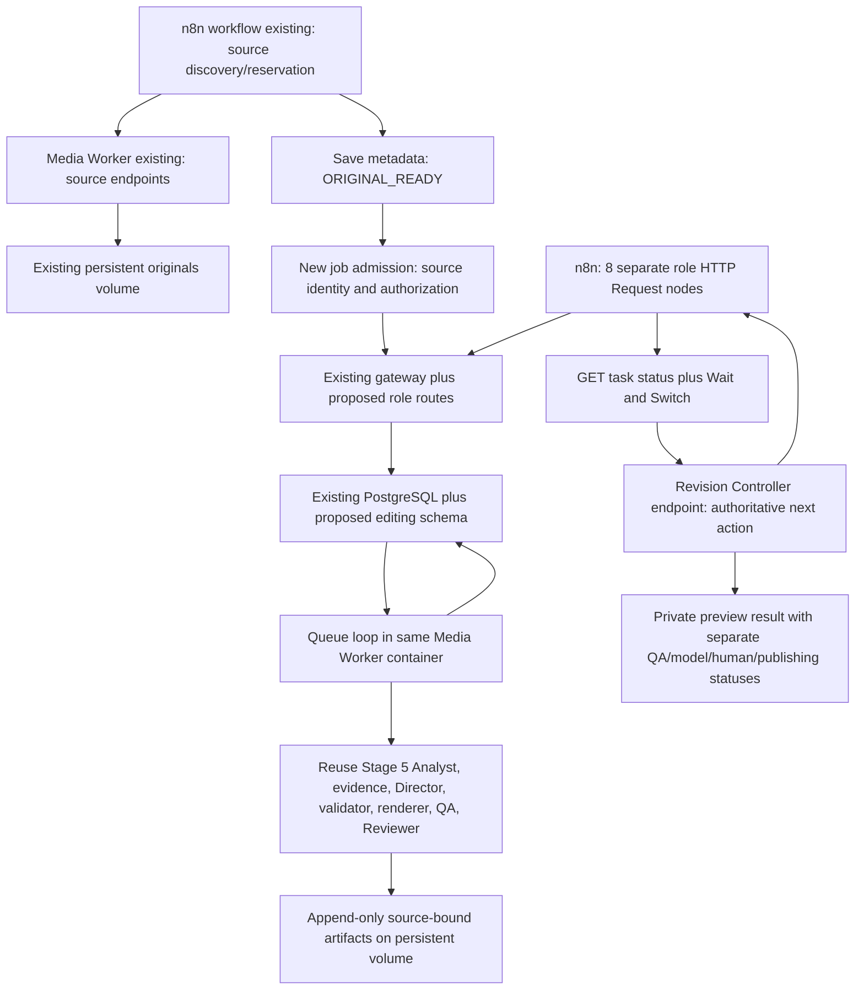

# Arsitektur modular n8n + backend + engine

Desain Stage 6.2, 14 Oktober 2026. Tidak ada service, module atau table baru yang
diimplementasikan oleh laporan ini. Target awal tetap **automatic private preview**;
production/publishing approval tidak diperkenalkan secara implisit.

## Bentuk deployment yang direkomendasikan

Pertahankan Media Worker existing sebagai satu aplikasi, lalu tambahkan modular
role routes dan loop queue di image Media Worker versi berikutnya. **Keputusan final
Stage 6.2 adalah satu backend/container modular**, mengikuti pola service Instagram
yang memuat agent files terpisah di satu proses API. Pekerjaan berat dijalankan
sebagai subprocess berbatas resource dari container yang sama; PostgreSQL tetap
durable queue. Tidak menambah executor/container khusus pada langkah awal.

Keputusan ini mensyaratkan image baru dengan Python numerik, FFmpeg, Node/OpenClaw,
schema/prompt dan adapter; limit 512 MiB Media Worker saat ini tidak cukup untuk
engine. Source endpoints existing dan volume tetap direuse, tetapi deployment
versi berikutnya adalah perubahan image/runtime yang perlu canary serta rollback.
Jika pengukuran menunjukkan API starvation, OOM atau tekanan host yang tak dapat
diterima, split API dan executor menjadi opsi lanjutan atau pindahkan rendering ke
host lebih besar. Lihat [resource planning](resource-capacity.md).

Gateway HTTP existing dapat direuse; tidak wajib mengganti stdlib HTTP server
dengan framework baru pada langkah pertama. Routes dan queue logic dipisahkan ke
file backend; handler hanya authenticate, validate, commit task, return 202.
Background queue loop dalam aplikasi mengklaim satu task pada satu waktu dan
meluncurkan subprocess engine. Satu heavy slot **dibagi** dengan source download/
decode agar kerja FFmpeg intake tidak bertumpuk dengan renderer/QA. Handler health,
status dan admission tetap singkat. Delapan role bukan delapan containers.

Layout pendukung minimal yang diusulkan: `backend/http_routes.py` untuk handler,
`backend/jobs.py` untuk transactions/state/budget, `backend/queue.py` untuk queue
loop, `backend/runtime.py` untuk subprocess/resource gate, `backend/artifacts.py`
untuk bridge receipts/writers existing, dan
`backend/roles/*.py` untuk delapan adapters pada mapping. Hindari framework role
registry/plug-in tambahan sebelum kebutuhan nyata muncul. Source Stage 5 tidak
direlokasi pada extraction pertama.

Diagram adalah target. PostgreSQL connection, originals volume dan source endpoints
sudah diamati; role routes/queue consumer/schema editing belum ada. Coolify Compose
services memakai network per resource; predefined network diperlukan untuk lintas
resource. Nama internal worker existing sudah digunakan node HTTP n8n. Koneksi
image Worker versi baru harus diuji kemudian, bukan disimpulkan dari label healthy.
[Coolify networking](https://coolify.io/docs/services/how-services-work)

## Storage dan path namespace

Reuse named volume `muxr6rvojjjdrjrp24yjimak_autoclipper-data` tanpa mengganti
originals. Desain mount:

- Source worker tetap melihat volume di `/data` dan originals `/data/source/originals`.
- Image Media Worker versi berikutnya menempatkan source aktif di `/opt/mandala`
  (ROOT existing berasal dari lokasi script), lalu mount volume lama di
  `/opt/mandala/data`. Source routes dapat memakai path dalam mount yang sama.
- Intake memetakan verified original dari namespace lama
  `/data/source/originals/VIDEO.mp4` menjadi logical path engine
  `data/source/originals/VIDEO.mp4`. Jika dua path perlu hidup selama transisi,
  gunakan mount volume yang sama pada kedua path dan buktikan bytes/device sama,
  bukan symlink. Metadata/receipt intake baru menyimpan
  mapping, upstream source_key/videoId, original SHA/bytes dan content-hash source ID.
- Job pertama dapat tetap memakai `data/revisions/stage59/automatic/vps-job-ID` agar
  ROOT guard existing tidak digeneralisasi sekaligus dengan extraction roles.
  Nama ini kompatibilitas namespace, bukan klaim Stage 5 historical job sudah pindah.
- Work dan output berada di mount yang sama; tidak memakai `/tmp` lintas filesystem
  untuk publisher hard-link. Direktori work mempertahankan prefix `.revision-work-`
  dan filter-safe name yang disyaratkan encoder.

Mapping mount perlu dibuktikan pada target: stat/device, ownership, permissions,
no-symlink guards, readers/writers, exclusive publication dan restore. Tidak membuat
mount atau menyalin evidence ke VPS sekarang. Originals read-only secara policy
engine; output hanya namespace engine baru. Historical bundles lokal tidak dipindah
atau dipakai sebagai proof target baru.

Persistent volume bukan backup; DB dan files perlu backup/restore terkoordinasi,
serta salinan off-server. [Coolify persistent storage](https://coolify.io/docs/core/persistent-storage/storage-mounts/overview)

## Memecah orchestrator tanpa melemahkan gates

`run_automatic_editing_v01.py` bukan API tahap tunggal. Extract secara bertahap:

| Batas existing | Pemisahan berikutnya | Invariant yang wajib tetap |
| --- | --- | --- |
| `prepare()` membuat job, storyboard, ASR/source review, request | Intake/request builder deterministic, Evidence tasks, ASR region tasks, Reviewer source mode dan speech finalization | Source refs/hash, real timing, classification/coverage, raw upload/response receipts; no speech → no ASR |
| `speech_evidence()` melakukan loop ASR + model speech review | Speech adapter hanya ASR/timing; Reviewer endpoint sendiri; controller memilih affected regions dan retry | Maks 2 ASR calls per region, failed/interrupted reservations tetap dihitung; successful regions reused, no synthetic timestamps |
| `run()` melakukan proposal loop, validation/render/review/selection | Satu Director proposal per task; Validator, Renderer, QA, Reviewer tasks terpisah; Controller mengarahkan next step | Max 3 Director reservations; malformed/failed calls tetap menghabiskan slot; tidak ada proposal loop kedua di n8n |
| `render_attempt()` melakukan permit/encode/publish/QA/manifest | Renderer consume permit + encode receipt; Technical QA menulis report terpisah; aggregator menulis final completion marker | Encode-only output bertanda ENCODED/QA_PENDING, bukan PRIVATE_PREVIEW_COMPLETED; failed QA MP4 tetap disimpan |
| `model_review()` inline response schema dan reservation | Reviewer module + shared schema builder untuk automatic family | Actual media SHA/request/prompt/raw binding, typed issue categories, model findings tidak menjadi human verified |
| `candidate_for()/select_candidate()/complete_candidate()` | Revision Controller + completion helper | Blocker tetap hard gate; sedikit major editorial notes, lalu total notes, lalu newest eligible attempt; replay kandidat sebelum selection |
| `code_receipts()/check_proof()/admit()` | Source-bound shared receipt helper + versioned integration envelope | Semua extracted module/config/schema/proof producer ikut code hash; fresh physical proof setelah refactor/environment change |

CLI existing tetap façade/reference path. Fase extraction perlu offline parity tests
untuk payload/diagnosis/budget/selection; jangan menduplikasi policy di module baru
dan CLI sekaligus. Pure compiler/validator helpers bisa dipanggil langsung setelah
input authoritative dimuat, bukan memanggil whole `run()` dari setiap role endpoint.

Admission renderer **tetap dilakukan segera sebelum encode**. Replay source/request/
packet/speech, raw Director/reservation, independent report/compiled spec/timeline,
current proof, code/environment dan exact permit. `/validator` response atau flag
di n8n bukan izin melewati `admit()`. Consume marker tetap dibuat sekali sebelum
encode. Tidak menambah `force`, skip validation, permit replay atau mode production
ke encoder. `render_video_v01 production` memang belum mempunyai executable
approval protocol dan tetap fail-closed.

Legacy Stage 5.7 adalah referensi checkpoint/budget design, bukan controller generik
siap pakai: source/path/permit Showcase dan budgets-nya berbeda. Stage 5.9 automatic
logic menjadi basis utama; jangan menambah batas 2 proposals historis Stage 5.7 ke
budget 3 Director proposals automatic atau menghapus human gates lama.

## PostgreSQL job management (rancangan)

Reuse database `mandala_autoclipper` dan public.source_videos. Tambahkan schema
`mandala_engine`; jangan membuat ulang source_videos atau menaruh engine state di
tabel internal n8n. Enam kelompok tabel cukup untuk versi pertama:

| Tabel proposal | Field/invariant inti |
| --- | --- |
| `jobs` | id, source_key FK, source_sha256, profile/request digest, policy/code/environment release, state, state_version, limits, authorized scope, selected_attempt, independent QA/model/human/production/publishing fields; unique service+idempotency key |
| `tasks` | id, job_id, role, phase, mode, attempt, input digest/refs, idempotency key, prerequisites version, state, worker, lease_epoch, lease_expires_at, heartbeat, deadline, output refs, failure class; unique job+role+phase/mode+attempt+input revision |
| `call_reservations` | job/task/role/region/attempt, prompt/request/source/config hashes, RESERVED/SENT/RECORDED/OUTCOME_UNKNOWN, raw/usage refs, created timestamps; unique effect slot; counters monotonic |
| `artifacts` | id, job/task/attempt, kind, logical path, sha256/bytes, upstream refs, code/environment/provenance generation, completion marker, evidence basis; append-only, no arbitrary client path |
| `permits` | id, service scope PRIVATE_PREVIEW_ONLY, exact source/proposal/execution/request/proof binding, attempt, consumed_at/worker epoch, exclusive file marker ref; existing automatic execution permit tetap `STAGE59_PRIVATE_PREVIEW`, one consumption per render attempt |
| `job_events` | event ID, job/version/task, transition, previous artifact/event hash, published/delivery attempts; append-only event log sekaligus optional callback outbox |

JSONB boleh menyimpan envelopes/refs; raw provider response dan media tetap dalam
bundle files. Schema/semantic/source validators tetap engine, bukan sekadar JSONB
column type. App user mempunyai izin terbatas schema engine dan lookup sumber;
migration privileges dipisahkan. Secrets tetap runtime secret mechanisms, bukan
job/event/artifact body.

Envelope service dan execution permit adalah dua kontrak berbeda: scope service
tidak mengganti `scope` bytes permit yang diperiksa `admit()`. QA completion helper
harus membangun final automatic render manifest yang cocok dengan
`verify_candidate()` (technical decode/audio/text + current code/environment refs),
sementara encode-only marker terpisah tidak diterima sebagai manifest completed.
Job completion baru terjadi setelah Reviewer dan candidate replay/selection selesai.

Source lifecycle DISCOVERED → RESERVED → ORIGINAL_READY tetap existing. Job editing
memakai QUEUED/RUNNING/AWAITING_DISPATCH dan terminal AUTO_PREVIEW_COMPLETED,
AUTO_PREVIEW_COMPLETED_WITH_NOTES, BLOCKED, FAILED atau CANCELLED. Ambiguous crash
masuk RECONCILIATION_REQUIRED, bukan terminal success. Tasks memiliki QUEUED/RUNNING
dan terminal SUCCEEDED/BLOCKED/FAILED/CANCELLED; paid effect yang tak terobservasi
OUTCOME_UNKNOWN disimpan pada reservation dan memblokir replay. Task SUCCEEDED
berarti role selesai, bukan seluruh job/technical/human/publishing PASS.

Queue awal menggunakan PostgreSQL claim `FOR UPDATE SKIP LOCKED`, short transaction
untuk QUEUED task → RUNNING + lease/epoch, lalu commit **sebelum** remote/FFmpeg.
PostgreSQL mendokumentasikan SKIP LOCKED cocok untuk queue-like table, bukan general
consistent reporting. [PostgreSQL 16 SELECT](https://www.postgresql.org/docs/16/sql-select.html)

Completion harus compare-and-set task/job version serta lease epoch. Fencing token
mencegah worker lama menerbitkan authoritative result setelah lease direclaim;
file output sendiri immutable dan exclusive. Semua file dibuat pada attempt/task
namespace; stale worker files menjadi diagnostic/orphan evidence, tidak dipromosikan.
Global render serialization tetap existing filesystem flock; satu queue consumer
dan satu heavy slot tidak membutuhkan distributed render implementation baru.

Database dan filesystem bukan satu atomic transaction. Urutan publication: reserve
DB effect/task → write append-only bound files + completion marker terakhir → CAS
DB artifact refs/result → optional event. Restart reconciler memeriksa marker/hash
dan ledger sebelum repair DB projection. File tanpa final marker tidak completed;
DB DONE dengan file missing/hash mismatch diblokir. Job artifacts tetap evidence
canonical, DB merupakan projection/index dan scheduler, bukan alasan rewrite bytes.

Paid invocation membutuhkan durable reservation sebelum API use, dengan distinct
caps: Director <=3; ASR <=2 per region; source Reviewer terikat assessment iterations
existing, edited-output Reviewer satu call per accepted attempt. Analyst belum
terintegrasi budget automatic existing; proposal v1 memberi satu admitted analysis
slot per job. Total calls bukan sekadar 3 Director slots. Unavailable provider cost
tetap NOT_REPORTED, tidak dianggap nol; deadline/money admission policy baru terpisah.

## Async execution dan n8n communication

1. Setelah ORIGINAL_READY, node admission mengirim source_key/expected SHA, brief,
   profile, private-preview authorization dan stable idempotency key. Backend
   validates live claim bila diperlukan lalu membuat job identity durable; tidak
   meminta claim_token source pada setiap role selama job editing berjalan.
2. n8n memanggil role endpoint yang cocok dengan `next_action` authoritative.
   Backend memeriksa prerequisites+state_version, commits task, returns 202.
3. Reusable status subworkflow melakukan GET task → IF terminal / Wait / GET ulang.
   Jangan memblokir request HTTP untuk render/inference. HTTP Request timeout adalah
   timeout initial response, bukan deadline keseluruhan job. [HTTP Request](https://docs.n8n.io/integrations/builtin/core-nodes/n8n-nodes-base.httprequest)
4. Pada task terminal, HTTP Revision Controller membaca saved artifacts dan
   mengembalikan next_role/phase/attempt+reason atau terminal result. n8n Switch
   routing itu ke node role khusus; tidak memodifikasi plan/budget/permit sendiri.
5. Reviewer `source_speech` masuk hanya pada speech branch. Jika ada subtitle_uncertain,
   controller schedules Speech/Evidence hanya region terdampak; source evidence
   finalized sebelum Director. Music-only langsung melewati ASR/source review.
6. Proposal rejected/technical fail → controller membuat concrete correction
   diagnosis untuk Director berikutnya bila budget tersedia. Editorial notes juga
   mencoba improvement dalam cap. Exhaustion memilih eligible candidate WITH_NOTES;
   blocker tidak menjadi advisory karena retry habis.
7. Completion mengembalikan private preview+artifact refs dan technical/model/human/
   production/publishing fields terpisah. Upload/delivery hasil editing adalah jalur
   berikutnya setelah admission yang sesuai; upload original existing dipertahankan.

n8n menjalankan dispatch graph; backend/controller menentukan transitions dan budget.
Tidak ada dua scheduler yang otomatis enqueue seluruh pipeline secara independen.
Jika n8n berhenti, task worker yang sudah diterima dapat selesai dan status tetap
durable; dispatcher resume membaca DB next_action dengan key yang sama. Recovery
node/subworkflow tidak menjalankan manual source discovery lagi untuk resume job.

Wait node tersedia untuk polling/resume; awal pilih polling sederhana dengan interval
bounded dan total deadline, kemudian callback authenticated bila diperlukan.
[Wait](https://docs.n8n.io/integrations/builtin/core-nodes/n8n-nodes-base.wait)
Retry On Fail di n8n boleh mengulangi **submit dengan key sama**, bukan menciptakan
paid attempt baru. Node actual execution failure harus dirutekan ke controller;
transport retry dan editorial revision berbeda.

## Recovery dan batas authorization

- Source reservation yang expired tidak otomatis menjadi kandidat lagi: query
  existing hanya DISCOVERED. Perlu sweeper/reconcile yang explicit dan fenced,
  preserve attempt_count, original file dan ownership; bukan reset massal ledger.
- Download berhasil tetapi metadata SQL belum selesai: revalidate original+claim,
  reconcile ORIGINAL_READY; jangan overwrite file atau paksa upload claim lama.
- DB task lease expired dengan paid reservation tanpa response: OUTCOME_UNKNOWN,
  count slot consumed, jangan resubmit API diam-diam. Only new controller-authorized
  slot bila budget masih tersedia.
- Permit consumed + incomplete encode: attempt tidak dirender ulang memakai permit
  yang sama. Preserve output/diagnostic; determine interrupted status before next
  bounded attempt. Jangan menambah hidden render retry budget.
- HTTP timeout setelah task committed: GET/deduplicate, bukan whole pipeline retry.
- Stale worker completion: rejected by epoch/version; tidak mengubah final pointers.
- Legacy stopped/exhausted jobs tetap terminal; code/env migration membutuhkan new
  lineage/report/proof, bukan pemulihan budget old job.

Service authentication dan job ownership wajib sebelum role submit; source claim
token adalah capability source reservation, bukan permission production atau model
inference budget. Semua hasil automatic tetap human_verified=false,
production_eligible=false, publishing_eligible=false. Human review dan publishing
admission adalah kontrak terpisah, belum diimplementasikan Stage 6.2.
