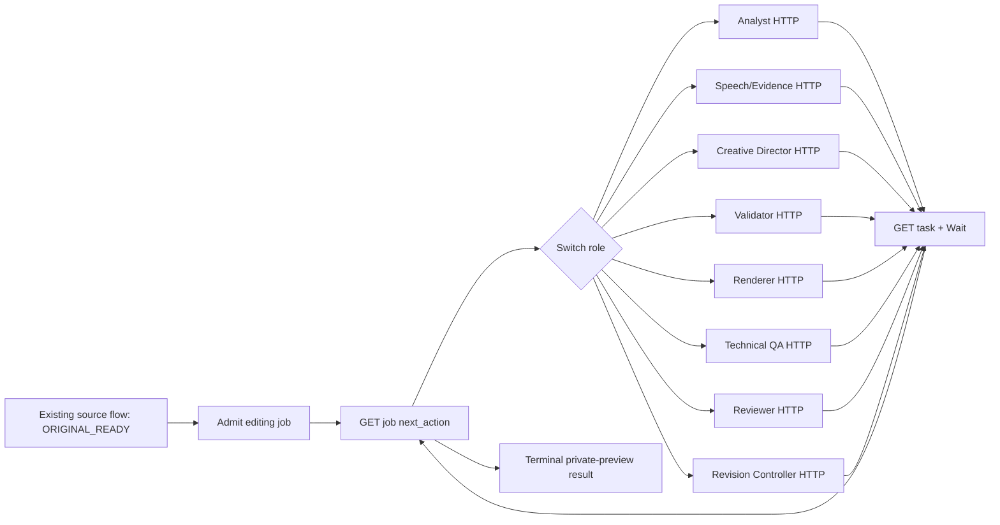

# Mapping role → modul → endpoint → node n8n

Semua file `backend/*` dan endpoint `/v1/*` di tabel ini **proposal**. Existing
`scripts/*`, schema dan source `/tmp/worker.py` tetap di tempat. Satu HTTP Request
node khusus per role mengirim task; node status/Wait digunakan ulang untuk menunggu.
Validator, Renderer dan Technical QA adalah role deterministic, bukan model AI baru.

Prefix proposal: `POST /v1/jobs/{job_id}/roles/`. API berada pada Media Worker
port 3002; **satu backend modular di container yang sama** mengambil task dari
PostgreSQL melalui loop internal dan menjalankan subprocess engine dengan batas
resource. Tidak ada container executor tambahan dalam desain final. Endpoint
berbeda tidak berarti delapan service atau delapan model baru.

| Role | Backend file proposal | Reuse Stage 5 | Endpoint suffix | HTTP Request node proposal | Input/output artifacts |
| --- | --- | --- | --- | --- | --- |
| Analyst | `backend/roles/analyst.py` | OpenClaw Analyst + TS video adapter, `validate_universal_analysis_v02.py`; reuse `find_analysis()` normalizer, bukan main hardcoded Showcase | `analyst` | `AI Analyst - Analyze Source` | source receipt+profile → raw/request/usage/provenance+Universal V0.2 canonical+metadata |
| Speech/Evidence | `backend/roles/speech_evidence.py` | `analyze_adaptive_av_evidence_v01.py`, `build_adaptive_director_input_v03.py`, automatic `timed_units`, `speech_evidence`, `verify_speech`; remote ASR helper | `speech-evidence` | `Speech & Evidence - Build Packet` | canonical+source → AV measurements, enriched packet, actual timed units/raw/upload receipts; NOT_REQUIRED or awaiting source speech review |
| Creative Director | `backend/roles/director.py` | `storyboard`, `prompt_for`, `run_adaptive_director_v03.live_response`, strict response parser | `director` | `Creative Director - Propose Edit` | bound packet/speech/storyboard+diagnosis+previous proposal → prompt/reservation/raw/typed automatic proposal+usage |
| Validator | `backend/roles/validator.py` | `automatic_editing_validation_v01.validate`, V0.3 independent validator+typed text policy | `validator` | `Validator - Validate Proposal` | proposal+packet+speech → independent report, visual plan, execution spec, timeline, blockers/advisories |
| Renderer | `backend/roles/renderer.py` | `automatic_editing_validation_v01.admit`, `renderer_revision_v02.encode`, compiler, existing render lock/publish | `renderer` | `Renderer - Encode Private Preview` | eligible bound plan/spec+current proof+fresh one-use permit → encoded MP4/ref+encode/decode/audio-mapping receipt; QA_PENDING |
| Technical QA | `backend/roles/technical_qa.py` | automatic `black_scan`, `stereo_headroom`, `visibility`, `glyph_clipping`, core verify_output/audio mapping | `technical-qa` | `Technical QA - Inspect Actual MP4` | encoded MP4+source/plan/spec/timeline+permit receipt → actual technical report + matched-control text measurements; PASS/BLOCKED |
| Reviewer | `backend/roles/reviewer.py` | automatic `model_review`, `review_video_quality_v01.invoke`/response bindings + `review_findings` | `reviewer` | `AI Reviewer - Review Media` | mode edited_output or source_speech, bound actual MP4+context → request/reservation/raw/response/usage+policy assessment; model_unverified |
| Revision Controller | `backend/roles/revision_controller.py` | `candidate_for`, `select_candidate`, `verify_candidate`, `complete_candidate`; patterns checkpoints/monotonic ledger Stage 5.7 | `revision-controller` | `Revision Controller - Decide Next Step` | saved validation/QA/review + budgets/candidates → retry diagnosis, next_role/attempt/affected regions, best candidate or terminal BLOCKED/completion |

`backend/roles/*` hanya lapisan pemanggil fungsi Stage 5 yang sudah ada. Modul
bersama yang diperlukan: `backend/http_routes.py` (auth/HTTP), `backend/jobs.py`
(transaksi/ledger), `backend/queue.py` (claim dan fencing), `backend/artifacts.py`
(hash dan receipt), `backend/runtime.py` (subprocess/resource gate). Setiap role
memakai context job yang dimuat dari server, bukan menerima path/FFmpeg arguments
dari n8n. Target satu image berisi Python, FFmpeg, Node/OpenClaw adapter dan file
schema/prompt; ini belum tersedia pada container 512 MiB sekarang.

Speech/Evidence memiliki dua phase pada endpoint yang sama: `measure` membuat AV
packet/classification; `transcribe` melakukan conditional region ASR setelah packet
tersedia. Tidak membuat timing bila provider tidak memberi timing. Source speech
assessment dipanggil melalui **Reviewer endpoint/node** dengan mode `source_speech`,
bukan paid call tersembunyi pada Speech/Evidence. Controller lalu memutuskan retry
region konkret atau memfinalisasi speech eligibility, maksimum dua attempts per
region. `verify_speech()` membutuhkan assessment yang terikat source; pemisahan ini
perlu refactor, bukan kemampuan yang sudah ada sekarang.

Director baru dijalankan setelah speech admitted atau NOT_REQUIRED. Storyboard
boleh disiapkan oleh intake/helper deterministic sebelum Director; frame references
dan timestamps tetap terikat request. Request Director selanjutnya mendapat diagnosis
tersimpan dari controller, bukan text bebas dari node n8n atau filter arbitrary.

Technical QA automatic dipakai untuk automatic manifest. CLI QA Stage 5.6 dan
revision verifier menerima keluarga manifest berbeda; jangan mengirim automatic
bundle ke verifier historis begitu saja. Reuse measurement helpers, lalu definisikan
envelope generation receipt baru dengan tests. Legacy Reviewer CLI dua media-role
juga tidak identik dengan schema inline automatic model_review.

## Endpoint pendukung proposal

| Endpoint | Fungsi | Node/helper |
| --- | --- | --- |
| POST `/v1/jobs` | Admit source ORIGINAL_READY + expected SHA + service authorization + policy/budget; membuat durable editing job | `Editing Job - Admit Original` setelah `Original Saved?` true |
| GET `/v1/tasks/{task_id}` | Status task dan refs hasil | `Task Status - Poll` + Wait + IF/Switch reusable subworkflow |
| GET `/v1/jobs/{job_id}` | Status agregat dan eligibility terpisah | `Editing Job - Status` |
| GET `/v1/jobs/{job_id}/artifacts` | Authorized manifest refs | `Editing Job - Read Results` |
| GET `/health/ready` | Dependency/path/proof availability, DB/storage readiness; tanpa paid inference/render | Operational readiness probe |

Existing `/health` dan `/source/*` dipertahankan kompatibel. Input task hanya IDs,
role phase/mode, expected job version, attempt dan server-issued artifact refs;
backend memuat dan memverifikasi payload authoritative. Jangan menjadikan n8n
transport MP4/base64, renderer specs arbitrary, izin produksi atau ledger budget.

## Envelope contoh proposal (bukan contract aktif)

```json
{
  "contract_version": "stage6-task-0.1-proposed",
  "phase": "propose",
  "attempt": 1,
  "expected_job_version": 4,
  "input_artifact_ids": ["packet-id", "speech-id", "storyboard-id"]
}
```

Header `Idempotency-Key` berasal dari stable job/role/phase/attempt/input revision;
service credential memakai n8n Credentials, bukan URL/payload/log. Success submit
202: task_id/job_id/state QUEUED/status endpoint. Duplicate identik mengembalikan task
yang sama; key dengan input digest berbeda atau prerequisites/version salah → 409.
Schema/range unsupported → 422, resource/budget gate ditolak sebelum inference.
Task terminal BLOCKED dilaporkan pada status payload; HTTP 200 GET bukan QA PASS.

## Kontrak role dan status yang harus diimplementasikan

Semua POST memakai `contract_version`, `expected_job_version`, `attempt`, `phase`
atau `mode` yang tercantum, daftar `input_artifact_ids` terbitan server, serta
`Idempotency-Key`. Backend menyimpan digest input dan membalas 202 dengan
`task_id`, `job_id`, `role`, `state=QUEUED`, `status_url`; GET task mengembalikan
`state`, `result_artifact_ids`, `failure_class`, `next_action` jika ada. `SUCCEEDED`
hanya berarti role menghasilkan artifact yang lolos gate role tersebut.

| Role / phase | Prasyarat authoritative | Output minimum dan outcome |
| --- | --- | --- |
| Analyst / `analyze` | ORIGINAL_READY, byte/hash+duration <=180 detik+payload <=20 MiB, profile dan request budget | raw request/response, usage, prompt/router provenance, Universal V0.2 canonical, validation; BLOCKED bila transport/schema/semantic gagal |
| Speech/Evidence / `measure` | canonical valid dan exact source | AV measurements, speech regions, enriched packet, timing class; `NOT_REQUIRED` bila music/no speech |
| Speech/Evidence / `transcribe` | affected region IDs dari controller, source-bound packet, ASR slot tersedia | per-region upload/request/raw/timed units; `OUTCOME_UNKNOWN` reservation bila provider outcome tak terbaca, tanpa timestamps sintetis |
| Creative Director / `propose` | admitted packet/speech, storyboard, Director slot <=3 | bound prompt/reservation/raw/proposal + usage; malformed/failed invocation tetap memakai slot |
| Validator / `validate` | proposal typed dan semua source refs | independent report, visual plan, execution spec, timeline; BLOCKED tidak dapat diteruskan ke render |
| Renderer / `encode` | independent eligibility, current proof, exact one-use permit dan `admit()` replay | MP4+decode/audio mapping/permit receipts; `ENCODED_QA_PENDING`, bukan completed |
| Technical QA / `inspect` | encoded MP4, declared plan/spec/timeline, source+permit refs | physical technical/decode/text/audio report; PASS atau BLOCKED, tanpa editorial approval |
| Reviewer / `source_speech` | timed units+source audio+Review reservation | source speech assessment/raw/usage; `model_unverified`, affected regions untuk controller |
| Reviewer / `edited_output` | actual MP4+technical QA report+matching context | edited-media findings/raw/usage; `model_unverified`, bukan human verified |
| Revision Controller / `decide` | current candidate reports+monotonic ledgers | typed `next_action` (role,phase/mode,attempt,regions,input refs,version) atau terminal selection+status, tanpa paid call |

Job state usulan: QUEUED → RUNNING/AWAITING_DISPATCH → AUTO_PREVIEW_COMPLETED,
AUTO_PREVIEW_COMPLETED_WITH_NOTES, BLOCKED atau FAILED. Crash ambigu memakai
RECONCILIATION_REQUIRED. Task state QUEUED → RUNNING → SUCCEEDED/BLOCKED/FAILED;
reservasi provider terpisah RESERVED/SENT/RECORDED/OUTCOME_UNKNOWN. Status
technical, model, human, production dan publishing adalah field yang terpisah.

## Satu workflow utama n8n

Target adalah memperluas workflow Mandala existing
[`ZAeqJqTuH83tu5rY`](https://n8n-lf4qpqzmntrt6iqw9hasvdfd.43.129.33.7.sslip.io/workflow/ZAeqJqTuH83tu5rY)
yang saat audit berawal dari manual trigger dan belum Published. Workflow Instagram
adalah pembanding pola, bukan workflow yang akan diubah. Satu workflow dimulai
setelah source flow existing mencapai ORIGINAL_READY, lalu
`Editing Job - Admit Original`. `Editing Job - Status` membaca `next_action` yang
diterbitkan backend. Satu Switch dispatch mengarahkan ke **tepat satu** dari delapan
HTTP Request node role pada tabel di atas. Setiap node mengirim POST dengan key
stabil; seluruh cabang bergabung pada `Task Status - Poll` → Wait → GET task sampai
terminal. Setelah task selesai, cabang menuju `Revision Controller - Decide Next
Step`; hasilnya kembali ke `Editing Job - Status` atau ke terminal result. Reviewer
dipanggil dua kali secara kondisional dengan `mode` berbeda melalui node Reviewer
yang sama. Speech/Evidence memakai phase `measure` atau `transcribe` melalui node
yang sama. Node n8n tidak menyusun ulang budget, mengubah permit, memilih kandidat,
atau menyimpan MP4 dalam execution data.

Cabang `Media Worker - Get Original File` → `Cloudinary - Upload Original` existing
tetap jalur delivery original. Admission editing dapat berlangsung setelah metadata
ORIGINAL_READY tanpa menganggap upload Cloudinary atau publish Instagram/TikTok
sebagai syarat editorial, kecuali policy job baru nanti secara eksplisit memintanya.



Revision Controller adalah satu-satunya pembuat attempt editorial baru. Source
speech review dapat meminta ASR hanya region terdampak, maksimum dua ASR calls per
region. Director maksimum tiga reservations, termasuk error/timeout. Setelah
validator blocker atau QA failure, controller menulis diagnosis typed untuk
proposal berikutnya. Kandidat eligible lama tetap tersedia bila proposal baru
gagal. Setelah budget habis, hasil dapat WITH_NOTES bila kandidat lama eligible;
blocker tidak dinaikkan menjadi advisory. Setiap render attempt memerlukan permit
baru dan marker konsumsi sebelum encode.

Callback optional memakai task/event ID stabil dan autentikasi; polling adalah
jalur awal yang lebih sederhana. Endpoint callback tidak diterima dari arbitrary
client URL. Retry POST HTTP harus memakai key yang sama; revisi editorial berbeda
adalah keputusan controller dan attempt baru yang tetap dihitung budget.
