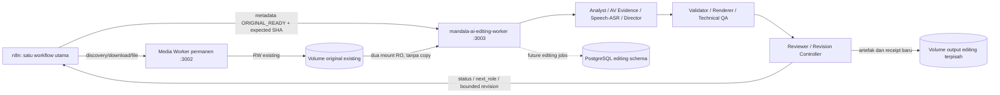

# Stage 6.3.4 — keputusan final dua worker

15 Oktober 2026. Dokumen ini **menggantikan rancangan cutover/satu Media Worker**
di Stage 6.2 dan laporan Stage 6.3.4 terdahulu. Perubahan pada dokumen ini dan
source runtime hanya lokal, belum di-commit/push/deploy. Service production,
workflow n8n, database dan original media tidak disentuh.

## Batas layanan

| Layanan | Tanggung jawab | API dan lifecycle |
| --- | --- | --- |
| Media Worker existing | Discovery/download original, probe/decode/hash, reservation check, delivery file existing | Service permanen, port 3002, empat endpoint existing dipertahankan. Tidak dikelola Compose baru dan tidak diganti image-nya |
| `mandala-ai-editing-worker` baru | Intake Stage 3 → Stage 5, sembilan modul role, job execution, validation/provenance/permit/budget/revision | Satu container editing, port 3003; saat ini hanya `/health` dan startup runtime gate. `/v1/*` dan role endpoints masih proposal |
| n8n existing | Satu workflow utama: source nodes memanggil worker lama, editing nodes memanggil worker baru | Workflow belum diubah; node per role tetap terpisah |
| PostgreSQL existing | Metadata sumber; editing job schema/ledger diusulkan terpisah | Tidak ada perubahan database atau credential production pada tahap ini |



Sembilan role memakai sembilan modul dan node HTTP dalam **satu editing container**,
bukan sembilan service. AV Evidence dan Speech/ASR memiliki node terpisah. Tabel role/input/output/status/revision pada
[role-endpoint-map](../stage62/role-endpoint-map.md) tetap berlaku, dengan seluruh
`/v1/*` diarahkan ke service baru. Contoh tujuan HTTP internal sesudah jaringan
disetujui: `http://mandala-ai-editing-worker:3003/v1/jobs/{id}/roles/analyst`.
Alamat/alias network itu harus dibuktikan melalui Coolify; belum koneksi aktif.

## Storage dan kontrak path

[`backend/compose.yaml`](../../backend/compose.yaml) berisi **hanya service baru**:

| Volume | Mount dalam editing worker | Akses | Fungsi |
| --- | --- | --- | --- |
| Original existing, external | `/data` | RO, `nocopy` | Menjaga path metadata Stage 3 `/data/source/originals/VIDEO.mp4` |
| Volume original yang sama | `/app/original-store` | RO, `nocopy` | Alias fisik untuk guard project root Stage 5: `/app/original-store/source/originals/VIDEO.mp4` |
| Volume output baru | `/app/data` | RW, `nocopy` | Evidence/jobs/proofs/ledgers/work/render/QA/revision milik engine editing |

Tidak menggunakan symlink atau menyalin MP4. `MANDALA_ORIGINAL_VOLUME` wajib
disetel ke nama existing yang telah diverifikasi pada Docker host yang sama.
Nama dari audit sebelumnya adalah
`muxr6rvojjjdrjrp24yjimak_autoclipper-data`; belum diverifikasi ulang pada tahap
lokal ini. `external: true` mencegah Compose diam-diam membuat volume original
kosong jika nama salah. `MANDALA_EDITING_OUTPUT_VOLUME` secara default
`mandala-ai-editing-output` dan harus berbeda dari volume original.

Contoh pemanggilan intake kelak:

```python
prepare_intake(record, storage_root=Path('/data/source'),
               stage5_video_path=Path('/app/original-store/source/originals') / f'{video_id}.mp4')
```

Record Stage 3 tetap memakai path `/data/source/originals/...`. Intake yang sudah
ada memeriksa identity, ORIGINAL_READY, SHA, bytes, durasi/FPS/resolusi serta inode
alias. Canonical input Stage 5 menggunakan alias di bawah `/app`; output baru
tetap memakai scope existing seperti `data/revisions/stage59/automatic/JOB_ID`.
Validator/root/permit/provenance Stage 5 tidak dilonggarkan. Work dan output perlu
berada pada filesystem output yang sama untuk publisher hard-link/exclusive.

`runtime_check --check-storage` memeriksa kedua direktori original readable dan
flag filesystem **ST_RDONLY**, alias direktori sama secara fisik, serta output
RW dan tidak menunjuk root/direktori originals yang sama. Probe tulis hanya pada
output melalui temporary file; tidak pernah mencoba menulis ke original. Saat
uji target tetap wajib memeriksa `docker inspect` untuk sumber mount/nama volume,
karena pemeriksaan path saja tidak membuktikan seluruh konfigurasi Docker.

Read-only di editing container tidak membuat original kebal perubahan dari
writer lama. Admission hanya untuk ORIGINAL_READY; periksa kembali hash/stat dan
binding sebelum setiap efek penting. Jangan membaca file partial dari tmp source.
Tidak melakukan `chown`, mengubah permission, atau membuat lock di volume lama.

## Perubahan source lokal

- `backend/Dockerfile`: image editing saja, expose 3003, entrypoint
  `python -m backend.editing_worker`. Runtime Python/Node/OpenClaw/plugin/FFmpeg,
  font/schema/prompts tetap direuse. Root `requirements-av*.txt` kini ikut COPY;
  `requirements-av.txt` diperlukan oleh receipt producer Stage 5 dan sebelumnya
  belum disalin meski ada di build context.
- `backend/editing_worker.py`: HTTP stdlib minimal, startup menolak runtime/storage
  invalid. Health menunjukkan service editing dan `roles_ready=false`. Tidak ada
  source download, paid call, job loop, atau role handler yang disamarkan aktif.
- `backend/runtime_check.py`: source RO dan output RW diperiksa terpisah;
  preflight canary tidak membutuhkan PostgreSQL/provider secrets.
- `backend/requirements.in` dan lock: buang yt-dlp/curl-cffi beserta transitif yang
  khusus downloader. Sembilan paket terkunci; psycopg tetap disiapkan untuk desain
  job store, tetapi tidak terhubung DB pada startup. Source Worker lama/snapshot
  dan konfigurasi VPS-nya tidak diubah.
- `.dockerignore`: source API `backend/media_worker/app.py` tidak masuk image
  editing. Config dan Intake Adapter tetap direuse; snapshot VPS tetap di Git
  sebagai evidence dan tidak masuk image.
- `backend/compose.yaml`, `.env.example`: hanya service/variabel editing dan
  volume baru. Tidak ada service DB/n8n/Media Worker, domain atau public port baru.
- `backend/compose.canary.yaml`: override untuk fixture volume original dan
  output canary yang sepenuhnya terpisah; tidak memakai nama volume production.

Role modules tetap direncanakan di `backend/roles/{analyst,av_evidence,speech_asr,
director,validator,renderer,technical_qa,reviewer,revision_controller}.py`.
Implementasi job/role endpoints berikutnya harus reuse fungsi Stage 5, menjaga
ledger monotonic, idempotency/fencing, source/code receipts, one-use permit,
attempt/budget limits dan status QA/model/human/publishing terpisah.
Receipt/proof lokal historis tidak menjadi capability proof target baru.
Perubahan code/environment/path memerlukan bundle dan proof target yang baru,
tanpa menulis ulang artefak lama agar lolos validator.

## Rencana pengujian Coolify — belum dijalankan

GitHub `nndoo/mandala-autoclipper-ai` sudah berisi baseline `7e6021a`. Commit itu
masih menjalankan entrypoint Media Worker lama. **Jangan deploy baseline itu
sebagai editing worker.** Revisi lokal ini memerlukan review serta persetujuan
commit/push sebelum Coolify memperoleh source baru. Auto-deployment harus tetap
off saat persiapan. User approval diperlukan sebelum membuat/menjalankan canary.

1. Setelah persetujuan, commit/push revisi dan catat SHA. Buat aplikasi/service
   **baru** bernama `mandala-ai-editing-worker` dalam environment canary; Dockerfile
   `backend/Dockerfile`, build context root `/`, build arg `MANDALA_PROVIDER_ID`
   cocok dengan `MANDALA_OPENCLAW_PROVIDER_ID`. Jangan menghubungkannya ke workflow,
   DB, secret provider, atau originals production untuk uji pertama.
2. Untuk canary Compose Git-backed, gunakan file dasar dan override:

   ```sh
   MANDALA_ORIGINAL_VOLUME=canary-only docker compose \
     -f backend/compose.yaml -f backend/compose.canary.yaml config
   ```

   Nama volume efektif harus **mandala-stage634-canary-originals** dan
   **mandala-stage634-canary-output**. Verifikasi konfigurasi render sebelum
   startup. Jika Coolify menggunakan Dockerfile application biasa, pasang dua
   bind mount RO dari volume fixture yang sama dan satu RW output terpisah yang
   setara dengan Compose; jangan mengandalkan nama service untuk storage otomatis.
3. Siapkan direktori `source/originals` pada **volume fixture canary saja** sebelum
   startup. Startup sengaja fail closed jika direktori tidak ada. Gunakan helper
   satu kali/terminal canary dengan mount fixture RW, lalu lepaskan helper dan
   pasang fixture RO pada service. Tidak menyalin original production; tidak perlu
   media nyata atau inference untuk runtime inventory dan health.
4. Build image, simpan log/digest/size. Uji Python, Node, OpenClaw versi, import
   dependency, plugin manifest/dist, FFmpeg/FFprobe/filters/font serta runtime_check
   di dalam image. Ketersediaan binary/plugin bukan bukti inference atau auth.
5. Jalankan container dengan kedua fixture source mounts RO dan output RW, tanpa
   domain publik. Uji preflight, `GET /health`, `/source/*` ditolak 404, dan role
   endpoints belum aktif. Verifikasi Docker mount source/flags, alias inode dan
   output-only write probe. Jalur ini tidak menyentuh database.
6. Ukur image size, idle/peak RAM, CPU, memory.peak, OOM events dan headroom host
   selama smoke. Profil awal editing 3584 MiB/1.5 CPU adalah usulan, bukan hasil
   pengukuran. Worker lama tetap limit/config existing. Host 2 core/7.4 GB dari
   audit sebelumnya belum dikualifikasi untuk dua workload berat bersamaan.
7. Hanya setelah review hasil dan persetujuan berikutnya: hubungkan volume original
   existing secara RO untuk intake compatibility read-only. Tidak merestart atau
   me-redeploy Media Worker lama. N8n dan schema/job DB tetap tahap terpisah.

Satu heavy slot hanya mengatur pekerjaan editing. Ia tidak mengunci download
worker lama; jangan menambahkan shared lock yang menuntut modifikasi worker lama.
Admission editing perlu headroom/backpressure dan penjadwalan n8n kemudian; uji
kontensi dengan download tetap dibutuhkan sebelum production readiness.

## Riwayat verifikasi revisi dua-worker awal

Hasil finalisasi terbaru (sembilan role) ada di
[laporan finalisasi](stage634-final-readiness.md). Tabel di bawah menyimpan
pemeriksaan awal revisi ini sebelum finalisasi.

| Pemeriksaan | Hasil |
| --- | --- |
| Storage/startup/HTTP isolation `test_editing_worker_runtime.py` | 7 test PASS; filesystem RO diuji melalui mock, bukan mount Docker nyata |
| Media Worker existing `test_media_worker_stage631.py` | 7 test PASS; parity offline |
| Intake Adapter | 10 test PASS |
| Automatic Editing Stage 5 | 19 test PASS |
| Stage 5.4 Planning Integration | 32 test PASS |
| Ruff `scripts tests backend` | PASS |
| Base dan canary Compose render + assertion isolasi service/mount/env | PASS; hanya editing service, dua source RO, output terpisah, tanpa credential DB |
| Static Docker context dari root | 108 file, 1.554.669 byte; semua COPY tersedia, source API lama tidak dikirim |
| Source Worker/snapshot, scripts/schema dan TypeScript runtime terhadap HEAD | Tidak berubah |

Total **75 test PASS** pada revisi dua-worker sebelumnya; hasil finalisasi terbaru
ada di [laporan finalisasi](stage634-final-readiness.md). Unit test storage memeriksa RO enforcement, alias mismatch,
penolakan output di volume original, output RO, dan bahwa probe tulis hanya ke
output. HTTP test memastikan identitas service baru, absennya source/role routes
dan startup yang menolak preflight gagal. Daftar file Git lokal kini 218;
`git-safe-files.txt` dan `coolify-build-context.txt` diperbarui untuk revisi ini.
Pengujian memakai Python `.venv-av` host, bukan dependency/image Docker baru.
Docker daemon lokal tidak tersedia; tidak ada build/runtime test VPS, pengukuran
image/RAM baru, inference berbayar atau editorial rendering pada revisi ini.
